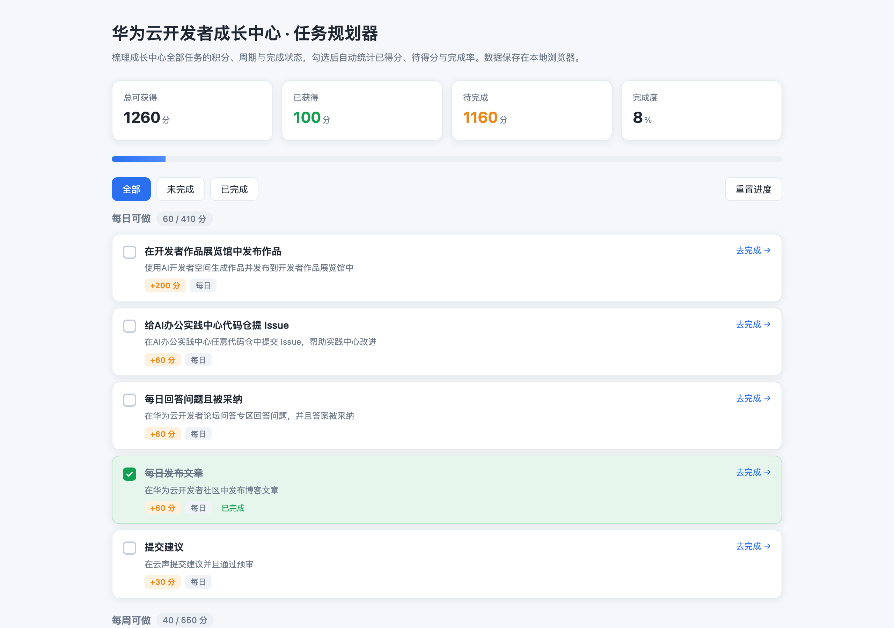

# 华为云开发者成长中心 · 任务规划器

一个零依赖的单页小工具，把华为云开发者成长中心的全部任务按**周期**整理清楚，勾选后实时统计已得分、待得分与完成率，帮你判断"接下来该做哪一项最划算"。

## 为什么做这个

成长中心的任务分散在博客、论坛、学堂、赛事、活动、作品展览馆等多个入口，周期规则也各不相同：有的每日刷新、有的每周一次、有的每月、还有的终身只能领一次。只看任务列表很难回答两个问题：

1. 我今天/本周还能拿多少分？
2. 剩下的分数里，哪一项性价比最高、最该先做？

这个工具把 15 项任务的积分、周期、完成状态汇总到一页，直接给出答案。

## 功能

- **周期分组**：每日 / 每周 / 每月 / 限次 四类自动分组，每组显示"已得 / 可得"
- **实时统计**：总可获得、已获得、待完成、完成度进度条
- **分值排序**：组内按积分从高到低排列，高分任务优先暴露
- **筛选视图**：全部 / 未完成 / 已完成 快速切换
- **一键跳转**：每项任务附官方入口链接，直接"去完成"
- **本地保存**：勾选状态写入 localStorage，关掉浏览器下次打开仍在
- **可重置**：一键恢复初始状态，重新规划

## 使用方法

直接用浏览器打开 `index.html` 即可，无需构建、无需安装依赖、无需联网。

```
git clone <仓库地址>
cd hw-grow-planner
open index.html
```

## 数据说明

任务数据来自华为云开发者成长中心公开的任务列表，包含 15 项任务、合计 1260 分。字段结构：

| 字段 | 含义 |
| --- | --- |
| `title` | 任务名称 |
| `bonus` | 完成可获积分 |
| `cycle` | 刷新周期（每日 / 每周 / 每月 / 限次） |
| `desc` | 任务说明 |
| `url` | 官方完成入口 |
| `done` | 服务端返回的完成状态 |

如需更新数据，替换 `index.html` 中 `const TASKS = [...]` 数组即可。

## 技术实现

- 纯静态单文件：HTML + CSS + 原生 JavaScript，无任何第三方库
- 渲染流程：`render()` 读状态 → 计算统计 → 按周期分组 → 按分值排序 → 生成 DOM
- 状态持久化：`localStorage` 键 `hw-grow-planner-v1`，仅存任务 ID 与布尔值
- 响应式：窄屏下统计卡片自动折行为两列

## 截图



## 说明

本工具为个人效率工具，任务数据仅供参考，实际积分以华为云开发者成长中心页面为准。
